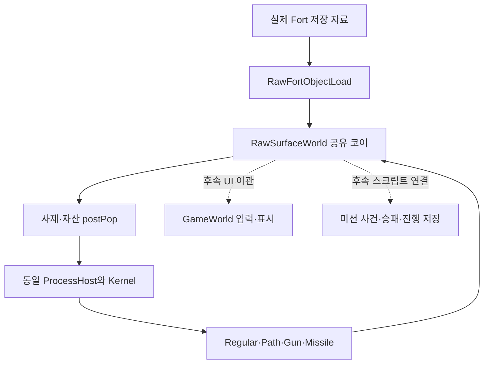

# 캠페인 1-1의 실제 월드 연결 준비

작업 및 마지막 정밀 디컴파일 PC는 **HJOW-Athlon, 2026-10-13**이다. 현재 정밀 원본과 기존 C++ 모듈을 읽어 연결 계약을 정리했다. 이 문서의 조사 자체는 신규 원본 실행 관찰·C++ 동작 대조·게임 플레이 검증으로 계수하지 않는다. `AGENTS.md`의 추가 지침에 따라 CD10.72 주소와 차이도 기록한다.

## 현재 공유 코어와 실제 소비자

`RawSurfaceWorld::Core()`는 단일 SID 풀·네 단계 공간 해시·spot·타입/프레임/SHP·장부·Frame/Owner·Pop/Unpop·Graph·Form 분배·ProcessHost·Kernel의 참조를 제공한다. 새 미션 연결은 이 자료를 그대로 사용해야 한다. `BindRuntime`은 첫 객체 생성 전에 한 번만 허용하며, 외부 바인딩을 해제하기 전에 `ClearProcesses`를 호출해야 한다.

| 연결 | 기존 실제 몸체 | 월드에서 공급할 값/효과 |
| --- | --- | --- |
| 저장 객체 | `RawFortObjectLoad` | 같은 factory·HP·contents, Terr→Chaff 순서와 원본 loadingDepth |
| owner 후처리 | `RawFortFinishOwner` | `AssetPostPopState.residences` 자체, 현재 지역/랜덤 배치 |
| 사제 | `RawPriestWorldBindings` | 같은 Reward/Frame/Owner/Spot, 피해·해방·배치·실제 Pop/삭제 |
| 기본 자산 postPop | `RawAssetPostPop` | 실제 GunProcess 생성·단일 신전/거주 구역/간헐천 목록 |
| Factory postPop | `RawFactoryPostPop` | 같은 outposts 목록과 실제 소유권 투표 |
| 주기 사건 | `RawAssetRegular::Handler` + 사제 Handler | 현재 게임 시각·같은 Host, 미복원 부모의 명시 거부 |
| 지역 소유권 | `RawRegionOwnership` → `RawRegionPaint` | 실제 outposts/작업장 목록·원소표·같은 표면 지도/소유자 |
| 받침 소유권 | `RawIslandPostPop::SetSupportOwner` | 기존 `RawSurfaceWorld::SetSupportOwner`를 재사용 |
| 이동 명령 | `RawPathStart` → `RawPathProcess` | 같은 search/runtime/data/Host와 현재 mapper·게임 시각 |
| 총 | `RawGunProcess` → `RawGunAnimation` | 실제 Target/DependForm·동맹·발사 간격·단계 소비자 |
| 투사체 | `RawMissile` → `RawGunHit` | 같은 factory/공간/Kernel와 실제 피해·비행/충돌 효과 |
| 신전 정리 | `RawVortexAscend` | 현재 섬 존재/owner 자료와 실제 가상 삭제 |
| 승패 | `RawMissionOutcome` | 단일 사제 목록/ownerState·신전 SID·현재 팀/스크립트 사건 |

지형 생성도 첫 raw 객체 생성에 해당한다. `BindRuntime` 이후 지형→저장 객체를 생성해야 하며 기존 `RawSurfaceWorld::Load`의 표면 정렬 경로로 Fort 객체 순서를 대신해서는 안 된다. `BeginLoad`의 표시/Graph 억제와 실제 Fort 로더의 공유 loadingDepth 증가를 조립할 때 원본 카운터를 추가 복제하거나 중복 증가시키지 않아야 한다.

## GameWorld에서 교체할 동작

현재 GameWorld는 Chaff를 먼저 값형 `Squid`에 넣고 비표면 객체를 임시 `GroundGrid`/`Squid::Advance`로 이동시킨다. 저장 필드가 없을 때 타입 defaultFrame을 채우며 지형 변형은 고정 CRT seed와 좌표 해시로 선택한다. 이 경로는 전체 원본 몸체 복원/동일성의 완료 근거가 아니다.

후속 이관에서는 생성·현재 상태·명령·삭제·표시가 동일 raw 슬롯을 사용하게 한다. 표시용 값이 필요하면 현재 슬롯의 읽기 전용 스냅샷으로 만들고 다음 프레임의 게임 상태로 되돌려 쓰지 않는다. 실제 Fort의 초기 프레임은 constructor와 저장 필드 쓰기 순서를 사용한다. 내용물 type6 Form을 살아 있는 골렘 자산으로 생성해서는 안 된다.

썬 캐논 외 초기 적 썬 디스크 발사기71의 발사 경로도 필요하다. 현재 새 Missile의 명시 지원은 최초 썬 캐논 경로이며, 다른 발사 부모·반사·빗나감·0거리의 미복원 분기를 예외로 유지한다. C++ 수명 검사에서 effectType0의 원본 자연 분기를 사용한 것은 실제 fieryTailSystem 타입11 비행 효과의 완료 근거가 아니다.

## 섬 자료에서 유지할 원본 필드

기존 `ChunkMap/IslandList`는 저장 패턴 배치에 필요한 owner/territory의 일반 경로만 보관한다. 실제 게임용 IslandList는 최대100개·레코드32바이트이며 다음 필드를 서로 구분한다. 오프셋은 **목록 객체 기준 `index*32 + offset`**이다.

| 오프셋 | 의미 | 확인 몸체 |
| --- | --- | --- |
| `+4` | 현재 신전 SID 등 지역 부착 값 | 패치`0046f260/0046f2c0`, CD`004bd9c0/004bda40` |
| `+8` | 존재 DWORD | 패치`0046ee30`, CD`004bd4c0` |
| `+0xc` | 현재 소유자 DWORD | 패치`0046f320`, CD`004bda70` |
| `+0x10` | signed territory BYTE | 패치`0046f200`, CD`004bd940` |
| `+0x11` | 저장 패턴의 원래 owner BYTE | 같은 Matches 몸체, 현재 owner 변경과 별도 |
| `+0x14..+0x20` | 네 float의 지형 범위 | 패치`0046f130/0046f190`, CD`004bd8a0/004bd900` |

CD`004bd480`은 번호가 count 안에 있는지만 검사하는 함수다. 실제 존재 DWORD 조회는 `004bd4c0`이므로 두 함수를 합치지 않는다. 초기화는 패치`0046edf0`, CD`004bd450→004bd3f0`, 추가는 패치`0046ee60`, CD`004bd500`이다. 실제 소유권 변경 패치`0046ef10`/CD`004bd670`은 revision·거주 구역 소유자·플레이어의 최초 지역도 처리하므로 DWORD만 바꾸는 구현으로 완성했다고 볼 수 없다.

캠페인에는 원래 owner BYTE와 현재 owner DWORD를 다르게 유지해야 하는 동작이 있다. Fort의 Terr 선택에 사용하는 원래 owner와, 신전/Ascend/피해·배치/미션 승패가 사용하는 현재 owner를 하나의 캐시 값으로 바꾸지 않는다. 향후 Ascend의 섬 개수 입력도 이 동일 자료를 읽도록 연결한다.

## 초기 지형과 완료 조건

초기 지형 프레임/stamp의 실제 대응은 패치`004c04b0/004c0640`와 CD`0049cf20/0049d2c0`다. 자동 대응표의 CD`0049d690`은 성장 helper이다. 초기 CRT99회 캐시와 이후 RegionPaint의 독립 로컬 seed0 캐시도 다르다. 근거와 남은 생성 효과는 [초기 지형 감사](cpp-initial-terrain-stamp-audit-20261013.md)를 따른다.

실제 캠페인 완료는 적 신전 파괴→사제 포획/운반→제단 다섯 룬 의식→사제 사망→`RawMissionOutcome`의 `[BadTeamDead]` 성공 사건과 진행 저장/다음 미션 UI까지다. 경제·AI·건설/생산·피해/효과·GUI도 원본과 대조해야 한다. 자세한 저장 입력과 행동 범위는 [캠페인 감사](cpp-campaign-1-1-runtime-audit.md)에 있으며 DirectDraw 전체화면 오류 수정은 현재 목표에서 제외한다.

## 상위 지형 생성에서 추가 확인한 범위

같은 호스트의 `terrainworld` 정밀 내보내기는 **패치10/CD10 함수·읽기 전용 종료0**이다. `tools/ghidra/terrainworld-functions.json`과 `extracted/terrainworld/`에 기록했다. 이 내보내기는 실행 관찰/구현 완료 입력으로 세지 않는다.

| 몸체 | 10.78 | CD 10.72 |
| --- | --- | --- |
| 실제 초기 context constructor | `004c0390` | `0049cdd0` |
| 청크/칸 bounds 저장 | `004c02d0` | `0049cd50` |
| 이웃 불일치 지면 x→= | `004c09a0` | `0049d890` |
| 도장 뒤 =/o/X→x | `004c0ad0` | `0049d9a0` |
| 지형 생성/도장 wrapper | `004c1510` | `0049e620` |
| 지형 생성 뒤 섬별 후속 배치 | `0046da70` | `00490530` |
| edgeFarm121 군집 배치 | `0040e560` | `0042cd80` |
| 영역 패턴의 항목 수 | `004bfde0` | `0040b9d0` |

초기 context의 code/region 시작은 패치 `+8/+0x10008`, CD `+4/+0x10004`이며 전체 크기도 패치0x20840/CD0x2083c다. 청크 bounds와 16배한 칸 bounds는 별도 필드다. 오른쪽/아래 청크 값이16을 초과할 때 청크 값만16으로 줄이고 이미 저장한 칸 bounds는 다시 계산하지 않는다. 패치는 이때 assert를 보고하며 CD는 조용히 줄인다. 자동 대응표의 constructor/bounds 주소와 이 실제 대응을 합치지 않는다.

일반 지형 wrapper는 실제 성장→x/= 경계 분류→Stamp('x')→문자 정리 순서다. 본섬 프레임/stamp 두 몸체만 연결해 전체 초기 지형 완료라고 표시하지 않는다. `0046da70/00490530`은 도장 뒤 현재 섬 목록을 순회하여 패턴 항목 수와 영역 사각형으로 **edgeFarm121**을 추가 배치한다. 이 타입을 간헐천122로 해석하지 않는다. 군집 배치의 local 난수·반복 실패30000회 제한·단일 `RawFortRandomPlacement` 소비자는 별도 후속 범위다. 저장 객체172개의 감사 수에는 이러한 생성 후속 객체를 임의로 합산하지 않았다.

`RawFortObjectLoad.Load` 자체가 공유 loadingDepth를 증가/감소한다. `RawSurfaceWorld.BeginLoad`가 현재 어댑터용으로1을 지정하는 규칙을 실제 loader의 증가와 중복 적용하지 않도록 상위 원본 호출 순서/기본 깊이를 계속 확인한다. 현재 준비 중인 `RawTerrainWorldBinding`은 동일 월드의 실제 Factory/가상 owner/Shape Pop/지역setter를 연결할 후속 초안이며 아직 CMake 등록·실행 근거에 포함하지 않는다.
