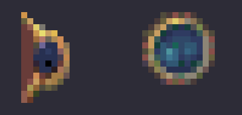

# 공통 메뉴 토글 표시 수정 — 단위471

사용자가 신고한 메인 메뉴 Options 하위 메뉴와 게임 중 ESC 메뉴의 토글 표시를 수정했다. 두 경로가 공유하는 `BindMenuGumpDrawAssets`가 원본과 다른 SHP 프레임을 선택하고 있었다. 작업일은2026-10-27, 현재 PC와 마지막 전체 정밀 디컴파일 PC는 **HJOW-Athlon / 마지막 수행일2026-10-23**이다. 디컴파일 산출물은 변경하지 않았다.

## 원인과 수정

10.78 메뉴 Draw `00476080`과 CD10.72 `004523b0`은 현재 fortGump 타입의 **+0x154 값+2**를 물리 프레임으로 출력한다. 타입의 첫 번호/개수를 작성하는 `0049b060`(CD `00444da0`)은 첫 번호16DWORD를+0x130, 개수16DWORD를+0x170에 각각 저장한다.

따라서+0x154는 `0x130+9*4`인 **J 구간의 첫 번호**다. I 구간의 개수는 `0x170+8*4=0x190`이다. 기존 구현과 이전 조사 문서가+0x154를 I.count로 잘못 해석했다.

| 항목 | 보호 원본 fortGump 값 | 선택한 그림 |
| --- | ---: | --- |
| 잘못된 구현 | I.count4+2=6 | B01 장식 조각 |
| 원본 방식 | J.first58+2=60 | J02 원형 토글 표시 |

두 판본의 `.type` 원문에서 I00=54, I.count=4, J00=58, J02=60을 확인했다. 실제 그림의 확대 비교는 아래와 같다. 왼쪽은 잘못 사용한6번, 오른쪽은 원본60번이며 **게임 화면 캡처가 아닌 원본 SHP 해제 결과**다.

`MenuGumpDraw.cpp`에서 `Run('I').count+2`를 `Run('J').first+2`로 고쳤다. 기존 SHP 캐시·팔레트·투명도·핫스폿·위치 계산과 입력 동작은 그대로 사용한다. `UberGump::RebuildControls`의 옵션 팝업과 ESC의 `OpenGameMenu`/`BindGameMenus`가 모두 같은 `MenuGumpControls::AddChecked`와 RawMenuControls Draw를 사용하므로 두 경로에 함께 적용된다. 잘못된 필드 해석이 들어 있던 헤더와 기존 조사 문서도 정정했다.

## 검증

[실행 보고서](../../cpppj/menu-toggle-marker-20261027.json)에 명령·종료값·원시 로그·실행 파일 SHA를 기록했다.

- 수정 전 제품에 새 픽셀 검사를 실행해 실패를 확인했다. 첫 검사 초안은 SHP rect의 양 끝 포함 폭을11로 오인했으며, 실제 `[-6,-6,5,5]`의12×12로 바로잡았다. 제품을 고치기 전에 다시 실행한 **2검사/6실패**가 잘못된 프레임 선택을 검출했다.
- 수정 후 **집중120개/실패0**(Menu109 + GumpDraw11), 신규2검사 모두 통과했다. 기존3,228등록을 보존했고 최종3,230등록이다. 전체 검사를 다시 실행한 수는 아니다.
- 첫 검사는 양판본의 실제 원본 J02 픽셀을 고정60번에서 직접 읽어 기준점/핫스폿, 상단·좌측 클립, 화면 밖 교집합과 행 padding을 포함한 전체 출력 버퍼를 비교한다.
- 둘째 검사는 실제 공통 메뉴 트리에서 `Sound On`, `Hide Island Ownership` 두 대표 행의 체크 on/off 차이가 원본 J02 픽셀만 추가하는지 비교한다. 미체크 행·글자·배경을 포함한 나머지 전체 픽셀도 동일해야 한다.
- Release 빌드3회(수정 전2회, 수정 후1회) 모두 종료0·경고/오류0이다. 최종 게임 SHA256은 `76c257c56bba1414f21449f916b8fb77aafc6d877c739ae98bc511a7b5660433`다.
- 보호 원본/CD/AGENTS와 기존 검사·fixture를 합한 최초3,160파일은 바이트동일이다. 기존 검사 본문을 수정하지 않았으며 테스트 CMake에 새 파일만 추가했다.

게임 프로세스·GUI·음향 장치와 전체CTest는 실행하지 않았다. 실제 메뉴를 열어 캡처한 결과나 전체 메뉴 외관의 동일성 검증으로 확대하지 않는다. 원시 로그는 `extracted/cpp-menu-toggle-471/`, 자산 확대 원시는 `extracted/menu-toggle-471/`에 있다. 이 수정과 별개로 NewFort 실제 Client 설치·Add Island·Test Battle/시나리오 및 전체 미션 자연 완주 목표는 계속 남아 있다.
