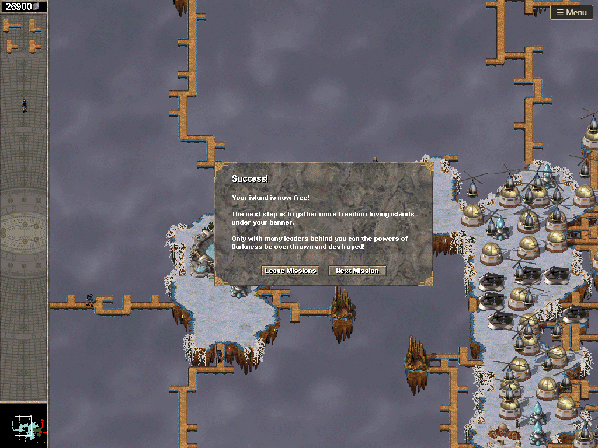

# 캠페인1-1 실제 아군 AI 승리

- 단위: WB04-E1368, 2026-11-26, HJOW-Athlon.
- 대상: The War Begins!의 실제 포획·희생·승리. 사용자가 허용한 검사 전용 아군 AI를 원래 Start가 끝난 직후 생성했다.

실제 적 사제 포획은 게임 시각715.65초, 제단의 원래 `finishSacrifice(18165)` 호출과 적 사망은854.15초다. 다음 프레임854.175초에 포획 상태가 해제됐다. 34,000프레임 관측에서 Success!와 Leave Missions·Next Mission 단추가 보이며 아군 사제는 살아 있다. pageerror·console error는0이다. 화면도 직접 확인했다.

SP·HP·기술·미션 게이트·완료값을 직접 변경하지 않았다. 실제 Kernel·렌더러·Canvas를 매 프레임 실행했다. 조회 함수를 감싼 기록기는 원래 반환과 효과를 보존하며 상태가 바뀔 때만 기록한다. 브라우저 관측이므로 cpppj와의 픽셀 일치 결과로 세지 않는다. 이 실행에서 새로고침 뒤 진행 복원을 검사하지 않았으므로 그 항목은 별도다.

[실제 로그](webpj-e1368-evidence/browser.log), [최종 원문 상태](webpj-e1368-evidence/result.json), [해시와 기록 시점](webpj-e1368-evidence/provenance.json)을 보존했다. 기록 시점은 실행 시작 시점과 다르다. Git에 보존한 도우미는 실제 실행한 조사 스크립트에 설명 주석만 더한 것이다.

재실행은 `webpj`에서 서버를 켠 뒤 `node tools/observe-ally-ai.cjs thewarbegins 60000`이다. 결과는 Git 제외 `extracted/`에 쓴다. 뒤쪽 미션은 이 도구로 실행하지 않는다. 진행 저장까지 확인하는 후속 도구는 `node tools/ally-ai-campaign-flow.cjs thewarbegins 60000`이다.

정기 Node26 전체 회귀6856/6856 통과, 실패0(1431466.1515ms). 로그는 Git 제외 `webpj/extracted/webpj-e1368-node26.log`다. 제품 www 수정이 없어 번들을 재생성하지 않았다.

