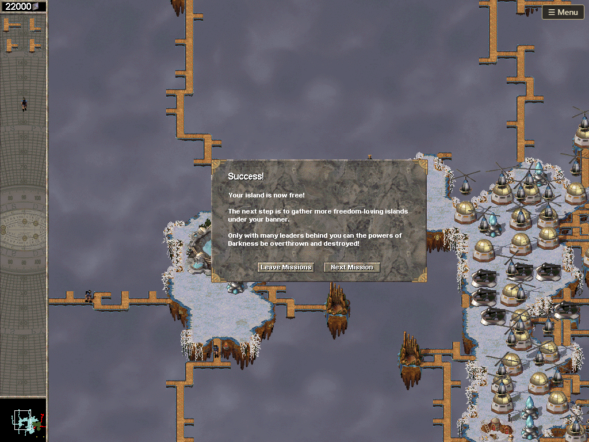
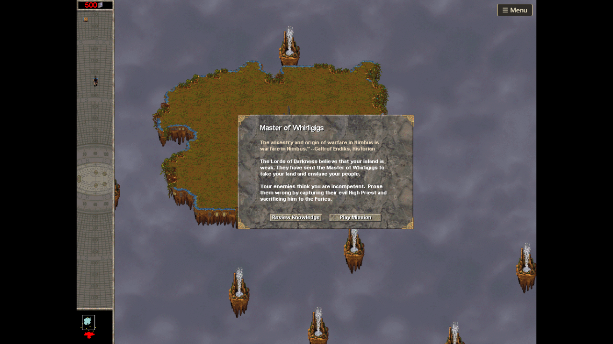

# 캠페인1-1 자연 승리의 저장과 다음 미션 복원

WB04-E1394, 2026-11-27, HJOW-Athlon. 제품www/번들은 E1393 그대로다. 자연 플레이와 저장 사본의 읽기 호환 검사를 구별해 수행했다.

신규 브라우저 저장소에서 실제 아군 AI로 The War Begins!를 플레이했다. SP/HP/기술/승패/진행값은 직접 쓰지 않았다. AI 생성 전후 현재 이름·SP3000·동맹·기술을 보존하고 아군 어려움/적 쉬움만 검사 정책으로 적용했다. 모든 Kernel·Renderer 프레임을 실행했고 최종 물리 Canvas 출력만 미뤘다.

적 사제 포획715.65초, 원래 finishSacrifice(18165)와 적 사망854.15초, 실제 승리 안내854.175초를 확인했다. 최초100프레임 간격 관측의 승리 시점은33800프레임이다. E1368의34000프레임 기록과 구분하며, 두 기록의 실제 포획/희생 시각은 같다. 아군 사제는 살아 있고 브라우저 게임 오류0이다.

첫 실행은 종료0으로 신규 완료값 `{"version":1,"values":{"DoneThewarbegins":"1"}}`의 실제 저장·같은 브라우저 새로고침 뒤 보존과 메뉴에서 다음 미션 요청 수락을 확인했다. 그러나 마지막 화면을 보니 요청 직후 메인 메뉴였고 다음 World의 실제 적재를 기다리지 않았다. 이 화면을 다음 미션 브리핑 증거로 사용하지 않는다.

검사 도구에 World 연결 완료·실제 게임 화면·브리핑 표시 대기를 추가해 자연 플레이를 재실행했다. 같은 승리와 저장 뒤 Next Mission의 실제 MasterOfWhirligigs World/브리핑까지 통과했다. 이후 page.reload의 기본30초 load 제한에서 실패했다. 두 번째 실행 전체를 성공으로 표시하지 않는다. 첫 실행·실패 로그를 모두 보존했고, 현재 도구는 긴 플레이 뒤 확인한 경계마다 결과를 저장하고 DOM 준비/앱 자체 준비를 따로 기다린다.

후속 검사는 첫 실행에서 **실제로 생성된 저장 문자열 그대로**를 새 검사 브라우저의 입력 자료로 삼았다. 이 사본을 새 자연 승리로 세지 않는다. Windows Chromium·Chrome·Edge·Firefox **4/4 통과**(31.8/33.1/30.2/35.4초)했다. 각 제품 번들에서 다음 순서를 확인했다.

1. 실제 Campaign → Struggle For Freedom 메뉴에서 해제된1-2를 선택한다.
2. 현재 Guide 이름과 함께 실제 World 연결/게임 화면/Play Mission 브리핑을 확인한다.
3. 그 World에 진입한 상태에서 새로고침한다.
4. 저장값 불변과 동일 메뉴의 해제 상태를 읽고 실제1-2 브리핑까지 다시 진입한다.

목표 수행이나 추가 완료값을 넣지 않았다. 검사 사본의 출처 해시는 e2e fixture와 [기록](webpj-e1394-evidence/provenance.json)에 있다. [최초 실제 결과](webpj-e1394-evidence/first-pass-result.json), [최초 로그](webpj-e1394-evidence/first-pass.log), [두 번째 시간 초과 로그](webpj-e1394-evidence/settled-pass-timeout.log), [호환 검사 원문](webpj-e1394-evidence/reader-matrix.log)을 함께 보존했다. 아래 화면에서 승리와 새로고침 후 실제 다음 브리핑을 직접 확인했다.

이 단위는1-1의 자연 승리에서 생성된 완료값의 저장/복원/다음 미션 해제를 닫는다. 최초/재실행/호환 검사의 각 범위와 실패는 위와 같이 구분한다. Linux의 읽기 호환은 E1397에서 이어 확인하며1-3/1-4/스커미시 자연 승리는 남는다. Node 문법 검사2개 통과, 제품www 수정이 없어 빌드는 재생성하지 않았다. 완료 순서는 E1395→E1394이며 E1393 전체 회귀 뒤2개 단위로2/4·6/8이다.
