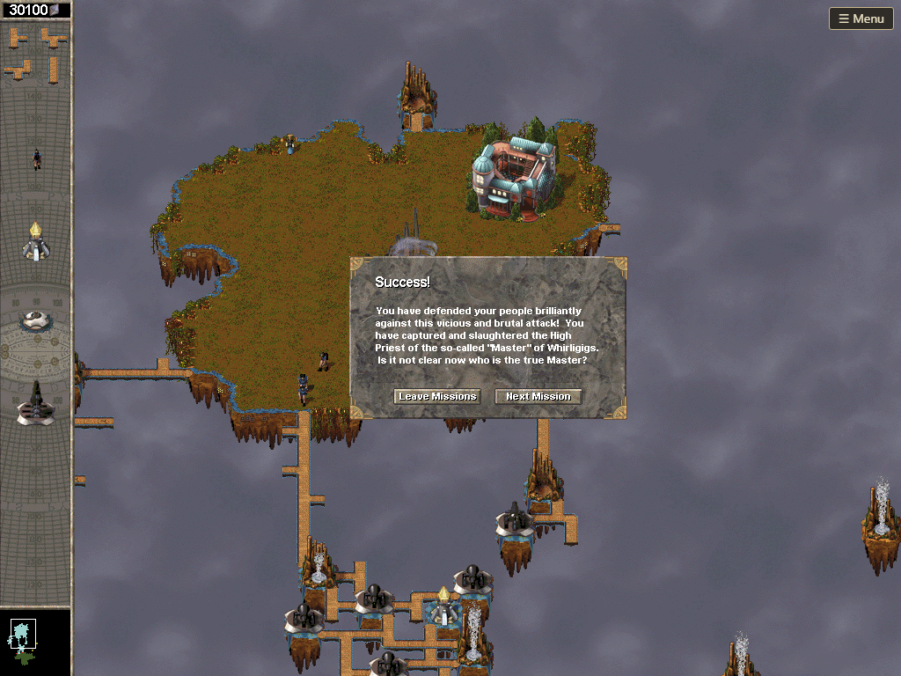
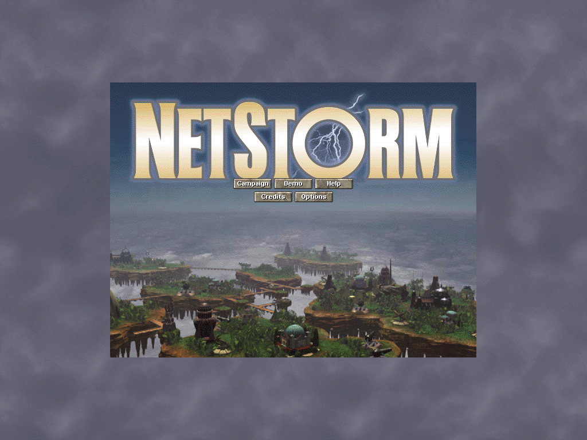

# 캠페인1-2 실제 승리와 진행 저장 복원

- 단위: WB04-E1369, 2026-11-26, HJOW-Athlon.
- 대상: Master Of Whirligigs. 실제 아군 AI 생성 전후 SP2000·이름·동맹·기술 목록이 같음을 단언했다.

게임 시각271.5초에 실제 적 사제가 포획됐고,413초에 원래 `finishSacrifice(15652)`와 적 사망이 일어났다.413.025초·16,200프레임에서 실제 Success!와 Leave Missions·Next Mission 단추를 확인했다. 브라우저 오류는0이며 화면도 직접 확인했다.

신규 브라우저 저장소의 진행값은 `null`이었다. 승리 후 실제 저장값은 `{"version":1,"values":{"DoneMasterofwhirligigs":"1"}}`이며 새로고침 뒤에도 같았다. 실제 Next Mission 단추로 SaveTheIsland 브리핑에 진입했다. 새로고침 뒤에는 Campaign → Struggle For Freedom 메뉴에서 실제 해제된 Save The Island 항목을 눌러 같은 브리핑에 다시 진입했다. 완료값을 직접 쓰거나 다음 미션의 목표를 수행하지 않았다.

장시간 검사에서는 최종 물리 Canvas 출력만 미루고 Screen·Renderer·Kernel·AI는 모두 매 프레임 실행했다. 별도2000프레임 대조에서 정상 출력과 이 방식의 전체 Session TSV·팔레트가 같고 화면 차이가0픽셀이었다(정상52,338ms·출력 지연34,837ms). 종료 화면은 원래 presenter를 복원해 출력했다. 이 결과는 현재 웹 실행 관측이며 cpppj와의 화면 대조 결과로 세지 않는다.

[실제 로그](webpj-e1369-evidence/browser.log), [승리·저장·복원 결과](webpj-e1369-evidence/result.json), [해시와 기록 시점](webpj-e1369-evidence/provenance.json)을 보존했다. 도우미 `webpj/tools/ally-ai-campaign-flow.cjs`는 실제 실행한 조사 스크립트에 설명 주석만 더한 것이다. `webpj`에서 서버를 켠 뒤 `node tools/ally-ai-campaign-flow.cjs masterofwhirligigs 60000`으로 재실행한다.

M4의 실제 승리 → 신규 완료값 저장 → 새로고침 → 다음 미션 해제 경로를 이 허용 미션에서 확인했다. 다른 허용 미션의 목표 수행과 한국어 전체 사람 검수는 별도 항목이다.

