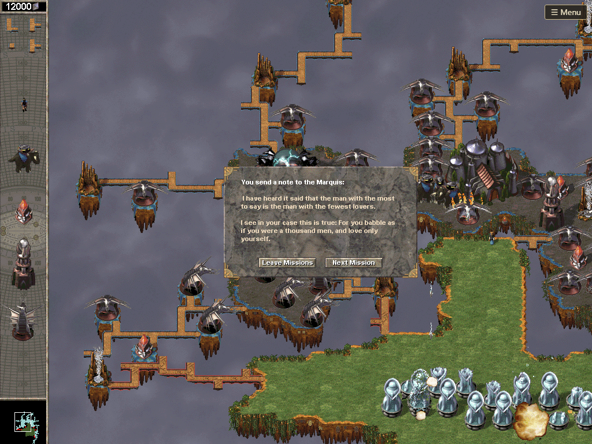
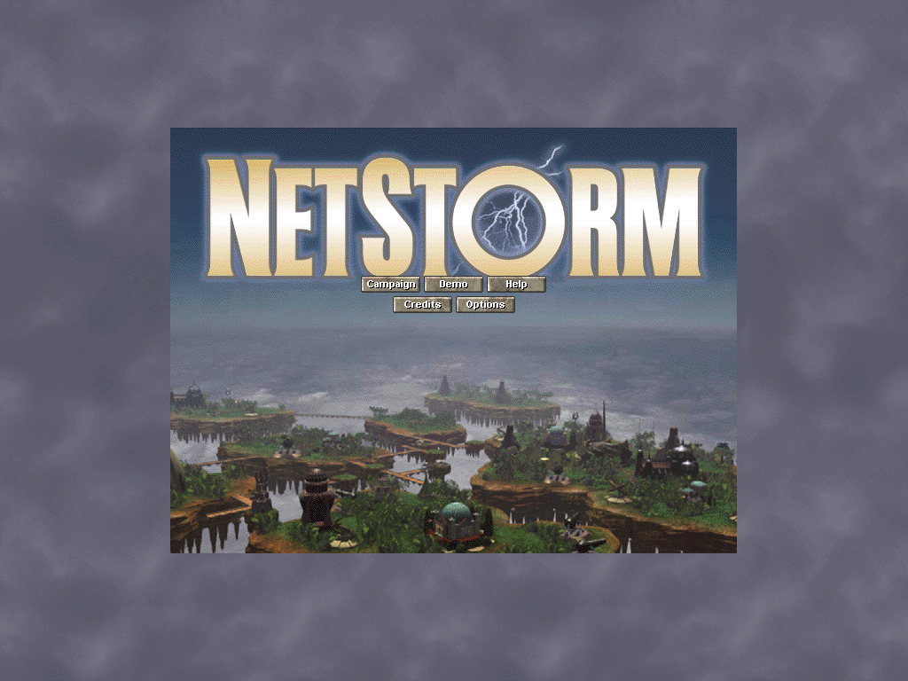

# 캠페인1-5 실제 AI 승리와 편지 뒤 진행 저장

- 단위: WB04-E1371, 2026-11-26, HJOW-Athlon.
- 대상: Thundering Power!의 실제 아군 AI 포획·희생·승리와 완료값 복원. 초기SP2400·이름·동맹·기술 목록 보존을 확인했다.

실제 포획은 게임 시각746.1초, 원래 `finishSacrifice(17116)`와 적 사망은926.925초다. 검사 루프37,400프레임의926.95초에 승리 뒤 편지(VictoryNote)의 Leave Missions·Next Mission 단추를 확인했다. 아군 사제는 살아 있고 브라우저 오류는0이다. 종료 화면도 직접 확인했다.

이 미션은 시작 브리핑이 두 장이다. 첫 시도는 A.의 Next 단추를 누르지 않아 Play Mission을 찾지 못했으며 실제 승리 검사로 세지 않았다. 도우미가 원래 A1. 단추를 눌러 둘째 브리핑에 진입하게 고쳤다. 진행 중 시간 안내는 항복하지 않는 원래 DoNothing 단추를 누르고, 승리 뒤에는 실제 VictoryNote 단추를 누른다. 해당 페이지의 원래 `$Config`가 완료값을 썼다. SP·HP·기술·게이트·완료값을 직접 변경하지 않았다.

승리 전 진행 저장소는 `null`, 완료 후에는 `{"version":1,"values":{"DoneThunderingpower":"1"}}`이다. 새로고침 뒤에도 같은 값이며 실제 Next Mission과 새로고침 뒤 Campaign → Struggle For Freedom → 해제된 Dissolved Alliance 항목의 두 경로로 다음 브리핑에 진입했다.1-6의 공격·포획·희생·승리는 수행하지 않았다.

[실제 원문 로그](webpj-e1371-evidence/browser.log), [결과](webpj-e1371-evidence/result.json), [종료 직전 전체 Session](webpj-e1371-evidence/terminal.tsv), [출처와 해시](webpj-e1371-evidence/provenance.json)를 보존했다. 실행 시작에 적재한 debug ESM은2392a50a6의 WWW 소스다. E1370의 선택 덤프 API는 그 뒤 추가됐으므로 새 번들 해시를 이 실행 당시 값으로 쓰지 않았다.

현재 `webpj/tools/ally-ai-campaign-flow.cjs`는 두 장 브리핑·시간 안내·승리 편지를 지원하고 상한 종료의 실제 AI 본문·전체 덤프도 남긴다. `webpj`에서 서버를 켠 뒤 `node tools/ally-ai-campaign-flow.cjs thunderingpower 60000`으로 재실행한다. 모든 Kernel·Renderer 프레임은 실행하고 물리 Canvas 출력만 미루며 종료 때 복원한다. 조사 실행본을 같은 도우미로 복사한 뒤 문법 검사를 통과했다. 이번 단위의 WWW 변경은 없다.

