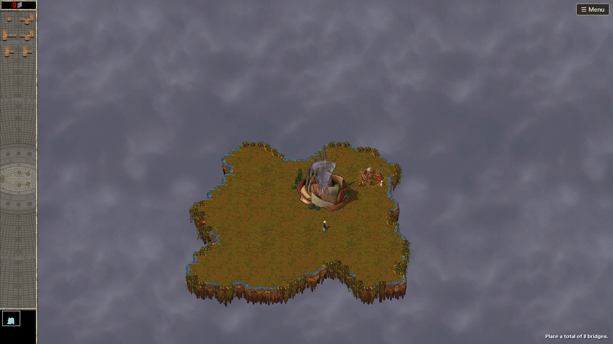

# 튜토리얼 안내의 실제 언어·화면비·전환 검증

WB-TUT-4 / WB04-E1389, 2026-11-27, HJOW-Athlon. 완료.

조건/문구는 [E1386](webpj-tutorial-objective-catalog-20261127.md), 표시기는 [E1387](webpj-tutorial-objective-gump-20261127.md), 실제 앱 수명은 [E1388](webpj-tutorial-objective-lifetime-20261127.md)에서 구현했다. 이 단위는 새 기본 표시와 기존 원본 비교 표시를 구분해 실제 브라우저와 정기 전체 회귀를 확인한다.

## 실제 Chromium

기본 새 표시에서 영어·한국어와4:3(1024×768)·16:9(1366×768)·16:10(1280×800) 여섯 조합을 확인했다. 실제 F4 입력으로 A→B, F8 안내 재열기, ESC 게임 메뉴 가림/복원, F1 도움말·F6 지식 창의 가림/복원, 글자 위의 입력 선택 제외와 ArrowRight32픽셀 이동을 검사했다. 같은 실행에서 실제 Canvas 크기와 화면비를 바꾼 뒤 문구·지도 하단 위치·입력을 다시 확인했다. 한국어는 실제 외부 갈무리11로 표시하며 배경/상자 없이 지도 위 글리프만 보인다.

정규 미션 제어 경로의 재시작·Tutorial2 전환·일반 캠페인 TheWarBegins 전환·미션 이탈·Tutorial1 재진입·앱 destroy에서 이전 문구/루트 참조를 반납했다. 단계·SP·목표·승패 상태를 주입하지 않았다. 튜토리얼 후반 포획/희생·특정 적 공격·승리는 실행하지 않았다.

첫 묶음14개에서 원본 대조6개와 기본 F4/F8/ESC·전환 수명2개가 통과했다. 여섯 화면 조합은 F1 도움말을 ESC로 닫는다는 잘못된 검사 기대가 실패했다. 실제 도움말은 OK 돌 버튼으로 닫는 기존 동작이므로 현재 언어의 실제 OK 좌표를 눌러 교정했다. 제품의 도움말 동작은 바꾸지 않았다. 여섯 조합은 재검사에서 모두 통과했다(1.6분). 성공한 고유 경로는 합계14개다.

별도 표시 부품 검사는 게임의 실제 gate를 바꾸지 않는 독립 루트에서 브라우저의 실제 글꼴로39키×3크기를 출력한다. 긴 문장 줄바꿈·혼합 글자·440폭·8픽셀 여백·글리프/그림자 두 색만 출력·입력 투과와 실행 전후 게임 덤프 불변을 확인한다. 이 검사는 후반 미션 목표 수행을 대신하지 않는다. 영어/한국어2/2가 통과했다(각12.0초). 독립 글리프 전진 폭 합산과 실제 줄 수를 비교했으며 영어 최장507픽셀은 두 줄, 한국어 최장432픽셀은 한 줄이었다. 첫 한국어 검사에서 모든 언어가 두 줄 이상이라고 가정한 기대는 실제 폭에 따라 교정했다. [측정 자료](webpj-e1389-evidence/font-metrics.json). 이2개를 포함해 성공한 고유 Chromium 경로는16개다.

| 실제16:9 영어 | 실제16:9 한국어 |
| --- | --- |
|  |  |

## 원본 비교와 배포

기존 시작 상태 대조는 고정 시각과 명시 `originalTutorialPresentation=1`에서 수행했다.4:3 결정론·16:9/16:10의90프레임 화면·90/130프레임 덤프, 한국어 M2의 상태/안내 창 밖0픽셀이 유지된다. 이 결과를 새 안내까지 원본과 같다는 의미로 사용하지 않는다. 조건 조회/표시의 기본값은 켜져 있으며 새 표시 검사는 원본 비교 선택을 사용하지 않는다.

제품 소스/Node 검사는 전체 회귀 중 고정했다. webpack3,497,856바이트와 E1388의 번들 재현1/1을 유지하고 자산333개와 manifest가 원본 준비 자료에 같은지 다시 확인했다. 실제 표시 증빙2장은 저장소에 별도 보관했다.

## 정기 전체 회귀

- Node26: **6,878/6,878 통과**, 실패/취소/건너뜀0,795.306초. `webpj/extracted/webpj-e1389-node26.log`.
- Node22.23.3: **6,878/6,878 통과**, 실패/취소/건너뜀0,674.318초. 위 Node26 종료 후 순차 실행했다. `webpj/extracted/webpj-e1389-node22.log`.

두 버전의 전체 회귀와 실제 Chromium16경로를 마쳐 TUT-1~4를 완료로 표시한다. 다음 정기 회귀는 E1393의 Node26, E1397의 Node26/22 순차 검사다. 기존1,007단위의 완료량과 원본 화면 일치량에는 새 기능을 가산하지 않는다.
